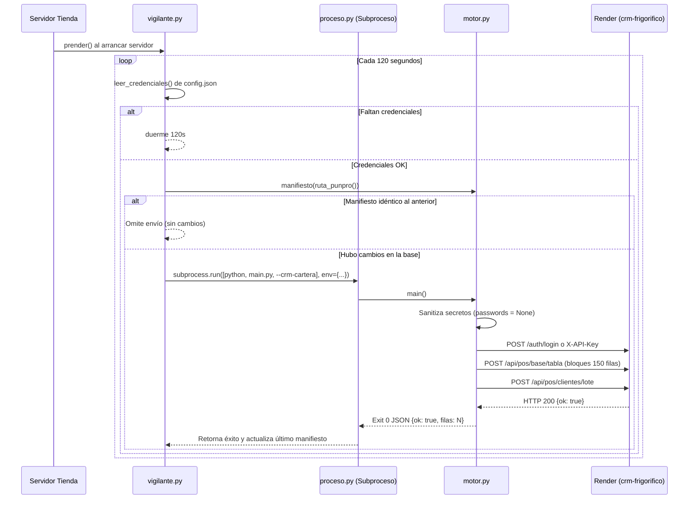

# Subcarpeta crm_salida (Transporte Espejo Nube a Render + Neon DB)

## Qué hace la carpeta
Esta subcarpeta contiene el motor de transporte autónomo encargado de enviar los datos locales de ventas, clientes y catálogo desde el TPV hacia el servidor en la nube de Render (`crm-frigorifico.onrender.com`), respaldado por PostgreSQL (Neon DB). Opera en segundo plano como un proceso hijo desprendido para no degradar el rendimiento del Servidor de Tienda ni de los puestos de cobro.

---

## Qué funciones tiene (Nombres Reales)

### 1. `motor.py` (Extracción, Sanitización y Envío HTTP)
* `leer_clientes(ruta_db: str) -> list[dict]`: Lee la tabla `clientes` de `punpro.db` en modo solo lectura (`mode=ro`). Descarta filas sin nombre y decodifica campos binarios.
* `huella(clientes: list[dict], marca: str) -> str`: Genera un hash SHA256 sobre la lista de clientes y la configuración para detectar si hubo cambios reales en la cartera.
* `manifiesto(ruta_db: str) -> str`: Genera la firma SHA256 completa de todas las tablas exportables de la base de datos.
* `leer_base(ruta_db: str)`: Generador iterativo que recorre todas las tablas de la base local, omitiendo tablas internas de SQLite (`sqlite_*`) y reemplazando con `None` cualquier columna sensible (`password`, `token`, `secret`, `api_key`). Inyecta la política de fiado de `configuracion`.
* `_pedir(abridor, req, timeout, intentos=4)`: Wrapper HTTP de `urllib.request` con reintentos automáticos para amortiguar el arranque en frío (cold start) de Render cuando responde con 502 Bad Gateway, 503 Service Unavailable o 504 Gateway Timeout.
* `subir_base(...) -> dict`: Envía cada tabla particionada en bloques de 150 filas hacia el endpoint `/api/pos/base/tabla`. Maneja renovación de sesión en caso de expiración durante la carga.
* `resolver_empresa(crm_url, api_key, nombre) -> str`: Consulta el endpoint `/api/pos/empresas/resolver` para traducir el nombre comercial de la empresa en su ID numérico en la nube.
* `entrar(crm_url, usuario, password) -> tuple[opener, empresa_id]`: Realiza login mediante `/auth/login` contra el CRM y devuelve el gestor de cookies de sesión (`CookieJar`).
* `enviar(crm_url, api_key, clientes, ...) -> dict`: Realiza el POST del lote de clientes al endpoint `/api/pos/clientes/lote`.
* `main() -> int`: Punto de entrada CLI del subproceso (llamado cuando `sys.argv` contiene `--crm-cartera`). Lee las variables de entorno, ejecuta la extracción y el envío, e imprime el resultado en formato JSON.

### 2. `vigilante.py` (Ciclo de Vida y Temporizador en Segundo Plano)
* `prender()`: Arranca el hilo vigilante daemon `_hilo` si no estaba encendido.
* `apagar()`: Señaliza `_parar` y espera que el hilo concluya limpiamente.
* `despertar()`: Fuerza un ciclo inmediato de sincronización (por ejemplo, al guardar credenciales en el diálogo de configuración).
* `leer_credenciales(origen=None) -> dict | None`: Extrae y normaliza `crm_url`, `crm_api_key`, `crm_usuario`, `crm_password`, `crm_empresa`, `crm_sucursal_id` de `config.json`. Devuelve `None` si faltan datos requeridos.
* `turno(rol, credenciales, lanzar, *, solo_maestra=False) -> str`: Ejecuta una iteración del ciclo. Si no es maestra y `solo_maestra=True`, omite el envío. Devuelve `'enviado'`, `'sin_datos'` o `'fallo'`.
* `lanzar(credenciales: dict) -> None`: Compara el manifiesto de la base actual con el último enviado. Si hubo cambios, inicia el subproceso desprendido (`subprocess.run`) ejecutando `proceso.comando()` con timeout de 900 segundos.

### 3. `proceso.py` (Desacoplamiento de Proceso)
* `comando() -> tuple[str, list[str]]`: Determina el comando para ejecutar el subproceso (`[sys.executable, main.py, --crm-cartera]` o el ejecutable congelado con `--crm-cartera`).
* `ruta_punpro() -> str`: Resuelve la ruta canónica hacia la base de datos de lectura (`punpro.db` local o `espejo_tienda.db` en modo esclava).

---

## Cómo funciona (Orden de Ejecución)

---

## Qué devuelve cuando falla

* **Falta de conexión / Internet caído:** `_pedir` atrapa `URLError` / `TimeoutError` tras los reintentos. `motor.py` sale con código `1` imprimiendo `{"ok": false, "error": "..."}`. `vigilante.py` registra un log de advertencia silencioso y programa el siguiente reintento en 120 segundos. **El servidor de la tienda no se interrumpe**.
* **Render dormido (Cold Start de contenedor web gratuito):** `_pedir` detecta los errores 502, 503 o 504 y reintenta hasta 4 veces con pausas de 3s, 6s, 9s, permitiendo que el contenedor de Render levante sin abortar el envío.
* **Credenciales incorrectas o vencidas:** Devuelve error de autenticación (`No autorizado`). El subproceso termina con código `1`. En la ventana del servidor se mantiene el estado anterior y el usuario puede volver a corregir la contraseña desde el botón `[Empresa del CRM]`.

---

## Qué NO debe cambiar una mejora futura

1. **Aislamiento de bibliotecas:** `crm_salida/motor.py` y `proceso.py` **nunca deben importar PyQt6 ni ningún componente gráfico**. Deben permanecer 100% compatibles con ejecución CLI en modo headless.
2. **Lectura estricta sin bloqueo:** La apertura de la base de datos para la réplica en la nube debe mantenerse con `uri=True` y `mode=ro` (`file:{ruta}?mode=ro`). Bajo ninguna circunstancia este módulo debe escribir en `punpro.db` ni abrir transacciones que puedan bloquear los cobros de los cajeros.
3. **Ofuscación de credenciales:** Las columnas y valores de claves y contraseñas deben ser filtrados antes de salir a la nube (`_clave_secreta`).
4. **Subproceso desacoplado:** Las llamadas a la API de Render nunca deben correr dentro del hilo principal del Servidor de Tienda; deben mantenerse siempre en un subproceso hijo (`subprocess.run`) con límite de tiempo para garantizar que la tienda local sea inmune a latencias de internet.
